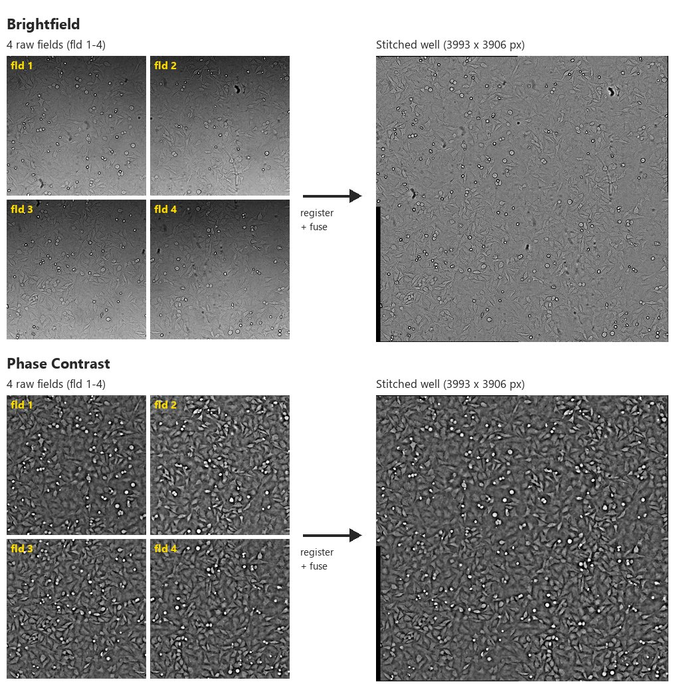
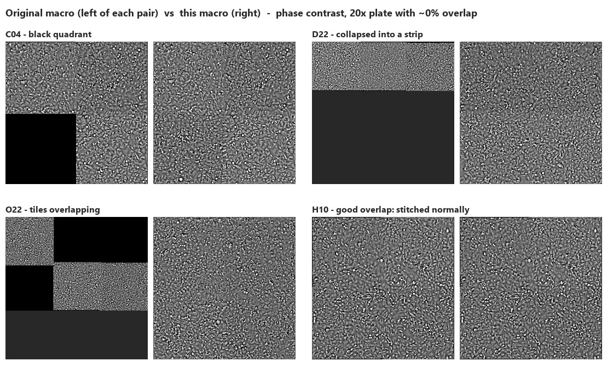
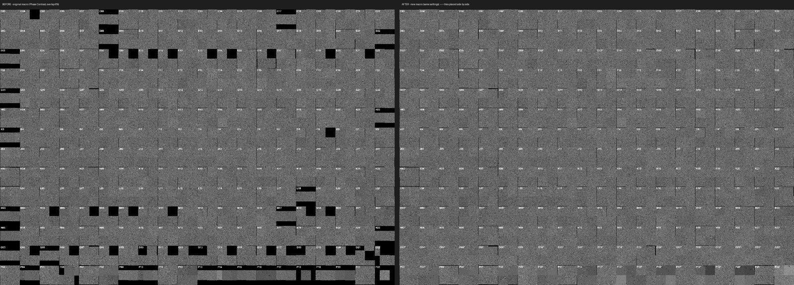
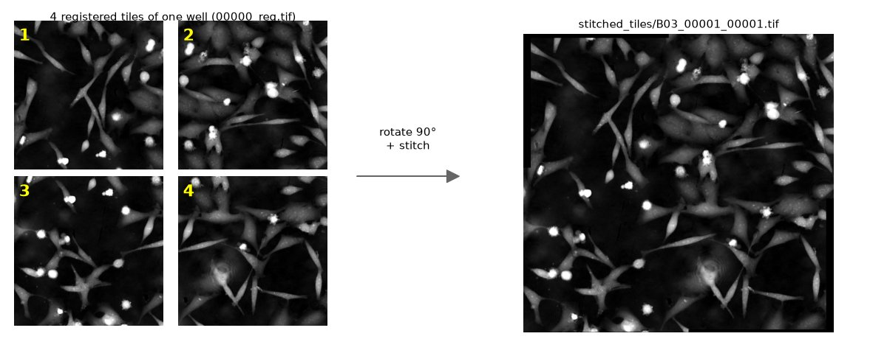
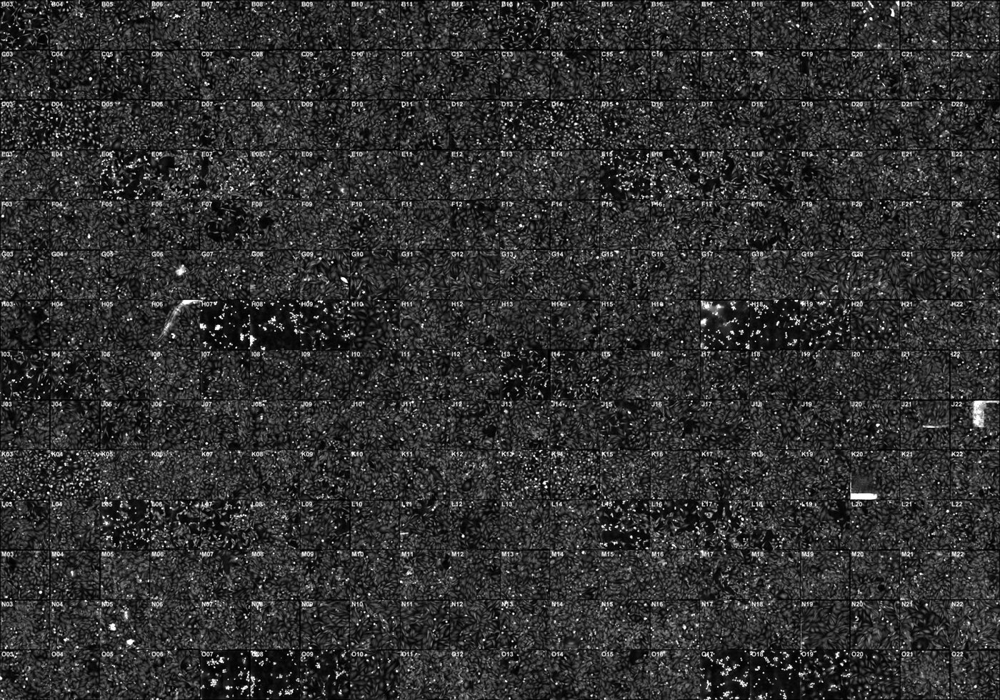
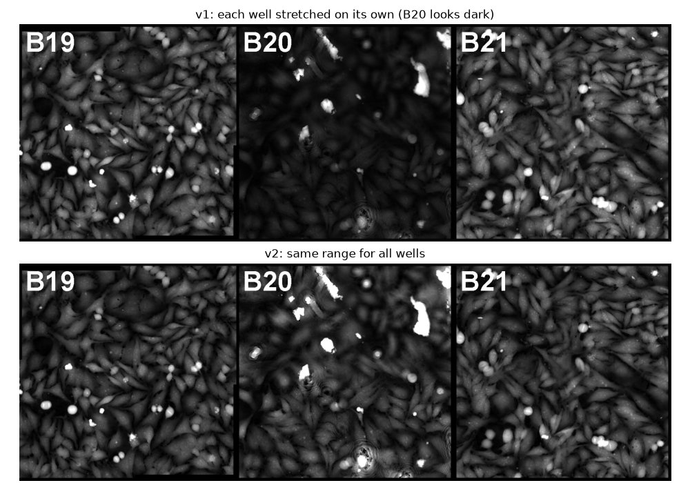
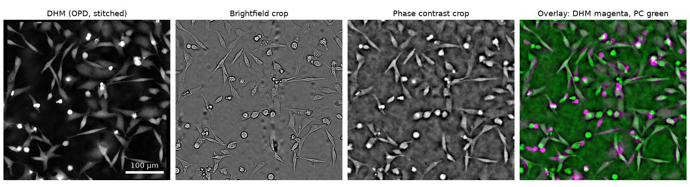
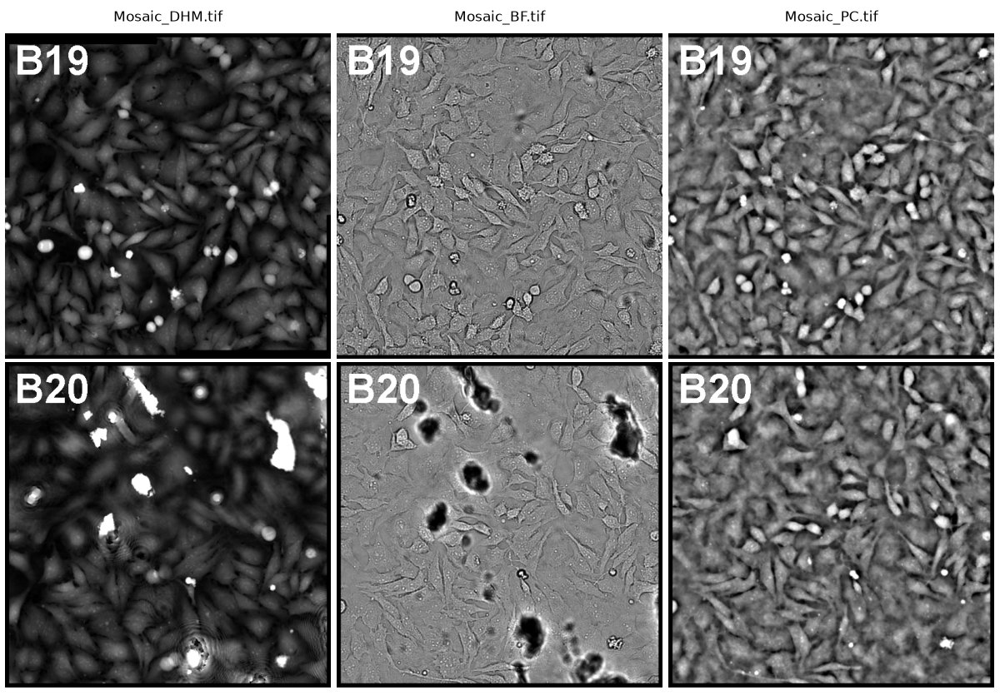

# Stitch-batch-BF-PC

Fiji macro that stitches every multi-field well of an IN Cell Analyzer plate, for brightfield and phase contrast together, and builds a labelled plate mosaic per channel in a single run. Wells that can't be stitched are tiled side by side instead of coming out broken.

The repository also contains macros for DHM (digital holographic microscope) plates:

- [`Batch_Stitch_Plate.ijm`](#stitch-the-dhm-tiles-of-a-plate) stitches the DHM tiles of every well.
- [`Mosaic_Stitched_Wells.ijm`](#plate-mosaic-of-the-stitched-dhm-wells) builds a plate mosaic of the stitched wells.
- [`Crop_BF-PC_to_DHM.ijm`](#crop-bf-and-pc-to-the-dhm-field-of-view) crops the brightfield and phase contrast images to the DHM field of view of each well.
- [`Mosaic_BF_PC.ijm`](#plate-mosaics-of-the-cropped-bf-and-pc-images) builds plate mosaics of these crops that overlay the DHM mosaic.



## Features

- **Shared registration.** Brightfield and phase contrast are registered once (2-channel, then BF, then PC) and fused with the same positions, so both outputs of a well align exactly.
- **No broken wells.** Each registration is checked against the expected grid. If every attempt fails, the tiles are placed side by side and the well is marked `*` in the mosaic.
- **Positions from metadata.** The `.xdce` file provides the field positions and pixel size for each well, at any magnification and for irregular layouts. Plates acquired edge to edge (0 % overlap) are tiled without stitching.
- **Even contrast per well.** BF tiles are flat-field corrected and PC tiles get their background offset removed. One contrast range is then applied to the whole well.
- **QC and speed.** You get a per-well CSV report, a Log summary with the measured overlap and a progress window. Processing takes about 4 s per well for both channels.

## Installation

Requires [Fiji](https://fiji.sc/) (tested with ImageJ 1.54p and Stitching 3.1.10, which is bundled) and ≥ 4 GB of memory.

Copy [`Stitch_batch-all-wells_Phase-contrast_and_Brightfield.ijm`](Stitch_batch-all-wells_Phase-contrast_and_Brightfield.ijm) to `Fiji.app/plugins/`, then restart Fiji. The macro appears as *Plugins › Stitch batch-all-wells Phase-contrast and Brightfield*.

## Input

One folder per plate holding the raw TIFF/PNG files, named with the IN Cell pattern, plus the `.xdce` file (recommended):

```text
TL and PC_1/
├── TL and PC_1.xdce
├── B - 03(fld 1 wv TL-Brightfield - Cy3 wix 2).tif
├── B - 03(fld 1 wv TL-Phase Contrast - Cy3 wix 1).tif
└── …
```

- The well is the text before `(`.
- The field number follows `fld `.
- The name must contain `Brightfield` or `Phase Contrast`.

## Usage

Run the macro, choose the input folder and keep the defaults. With 2 × 2 fields and *Right & Down*, fld 1 is top-left and fld 4 bottom-right.

| Parameter | Default | Description |
|---|---|---|
| Target Channel | Both | Both channels with a shared registration, or a single channel |
| B&C Saturation (%) | `auto` | 1.5 for BF, 1.0 for PC; a number applies to both |
| Overlap (%) | `auto` | Read from `.xdce`. Without metadata, 6 %. A number forces a regular grid. |
| Grid Size X / Y, Grid Order | 2 / 2, Right & Down | Acquisition grid; only fields 1 to X × Y are used |
| Min. overlap to stitch (%) | 1 | Below this overlap, wells are tiled side by side |
| Max tile shift (% of tile) | 10 | A registration that moves a tile further than this from its expected position is rejected |
| Mosaic scale | 0.33 | Size of each well in the plate mosaic |

## How it works

1. **Expected positions.** Each tile's position is computed from the `.xdce` field offsets. The average overlap decides whether stitching is attempted.
2. **Correction.** BF tiles are divided by a Gaussian-blurred copy (σ = 50 px). PC tiles have their median subtracted. The well's combined histogram sets one contrast range for all its tiles.
3. **Registration.** Fiji's *Grid/Collection stitching* runs on the combined BF + PC tiles, then on BF alone, then on PC alone. A result is kept only if every neighbour offset is within *Max tile shift* of the expected one. On a difficult plate, this cut unstitched wells from 16 (BF only) and 20 (PC only) to 5 out of 280.
4. **Fallback.** When fields share too little content, the plugin silently drops tiles at (0, 0), which gives black quadrants or collapsed strips. Such results are rejected and the tiles are placed side by side.
5. **Output.** Both channels are fused (linear blending) at the same positions, then the thumbnails are assembled into one mosaic per channel.





## Outputs

Written inside the input folder:

```text
Merged_Images_Brightfield/      <well>(wv …)_merge.tif (16-bit) + Stitching_report.csv
Merged_Images_Phase Contrast/   same for phase contrast
Mosaics/                        Mosaic_Brightfield.tif, Mosaic_Phase Contrast.tif
```

`Stitching_report.csv` has one row per well with these columns:

- Well
- Tiles
- Result: stitched, or tiled side by side with the reason
- Registration used
- Max tile shift (px)
- Rejected registrations

The Log summarises the outcome, the measured overlap and the timing.

**Tested** on three IN Cell 2200 plates:

- 20x, 0 % overlap: 280 wells tiled side by side, where the original macro produced about 100 broken images.
- 20x, 5–7 % overlap: 280/280 wells stitched.
- 10x, irregular layout: 4/4 wells stitched.

## Troubleshooting

| Symptom | Solution |
|---|---|
| Many wells tiled side by side | Too little overlap; check *Measured overlap* in the Log. Acquire with 5–10 % field overlap. |
| `Overlap below 1%: stitching skipped` | The metadata says the fields are edge to edge. Type an overlap value to force stitching. |
| Positions don't match the grid size/order | Fix Grid Size/Order, or type an overlap value to ignore the metadata |
| `No '...' images with valid well names` | Check the file-name pattern (see [Input](#input)) |

## Versions

- **3.1:** per-well contrast, per-well positions from metadata (10x, irregular layouts), 2.4× faster, progress window.
- **3.0:** BF and PC in one run with a shared registration.
- **2.2:** `Mosaics/` folder.
- **2.1:** overlap from `.xdce`.
- **2.0:** registration check with side-by-side fallback, and the CSV report.

The full changelog is at the top of the macro.

## Stitch the DHM tiles of a plate

[`Batch_Stitch_Plate.ijm`](Batch_Stitch_Plate.ijm) stitches the 2 × 2 registered DHM tiles of every well and names each result after its well position, e.g. `B03_00001_00001.tif`.



**Input:** choose the `Registered` folder of a DHM acquisition.

```text
<acquisition>/
├── experimental_info.json                 first well (InitialPosition), pixel size
├── RRRRR_CCCCC/<tile>/…/timestamps.txt    raw tiles: stage positions
└── Registered/                            ← choose this folder
    └── RRRRR_CCCCC/                       one folder per well
        ├── 00001_00001/Registered/00000_reg.tif
        └── 00001_00002/…, 00002_00001/…, 00002_00002/…
```

**How it works**

1. **Seed.** The tiles are rotated 90° right and placed at their recorded stage positions.
2. **Scale.** The µm-to-pixel scale is measured by stitching a few wells spread across the plate. It isn't read from the json, which can name the wrong objective: 40x acquisitions report 20x and 0.3 µm/px.
3. **Refinement.** *Grid/Collection stitching* refines the positions. If any tile moves more than *Max shift from seed* (60 px), the refinement is rejected and the tiles stay at their stage positions. Without this check, the plugin silently stacks an unmatched tile on top of tile 1.

**Options:** stage seeding on/off, objective magnification (0 = auto), max shift from seed, and tile overlap (used only when there are no stage positions).

**Outputs** (`Registered/stitched_tiles/`):

```text
<Row><Col>_<well folder>.tif   32-bit, original values (only the display contrast is set)
qc_report.csv                  per well: seed source, step, overlap, max deviation, verdict
```

Each well gets one of four verdicts:

- `REFINED`: the stitching was accepted.
- `SEEDED`: the tiles were placed at their stage positions.
- `UNCHECKED`: the stitched positions couldn't be read, so the stitching was kept without checking.
- `FAILED`: no image was produced.

On the 20x test plate (280 wells), about 85 % of the wells were refined and the rest were placed at their stage positions.

## Plate mosaic of the stitched DHM wells

[`Mosaic_Stitched_Wells.ijm`](Mosaic_Stitched_Wells.ijm) assembles the stitched wells into one plate image, with each well at its plate position and labelled.



**Usage:** choose the `stitched_tiles` folder. Any folder of `<Well>.tif` or `<Well>_….tif` images also works. The mosaic is saved as `Mosaic_DHM.tif` in the parent folder, or as `Mosaic_BF.tif` / `Mosaic_PC.tif` for a folder called `Brightfield` / `Phase Contrast`. The name can be changed in the dialog.

- Each well is cropped to a centred square of the median image size and downscaled (default 0.33).
- **Same range for all wells** (default):
  - All wells share one display range, so they can be compared.
  - The range is either `auto` or typed in. `auto` is the median of the wells' own ranges, each with 0.7 % of the pixels saturated and empty pixels ignored.
  - You can choose the LUT and add a colour bar (off by default).
- **Per well:** each well is stretched on its own, as in v1.
- **Log:** lists the wells whose own range is more than 1.5× wider or narrower than the plate's. This flags debris, unwrapping errors or strong drug effects.
- **16-bit output:** a 32-bit mosaic (DHM) is saved as 16-bit, half the size, and looks the same on screen (at most 1 grey level in 256 differs).
  - The values are mapped linearly onto 0–65535, and an ImageJ calibration (*Analyze › Calibrate*) maps them back. The status bar, *Measure* and *Brightness/Contrast* therefore show the original DHM values, to about 0.001.
  - Values more than 7.5 display ranges beyond the display range are clipped; they were already black or white on screen.
  - Set `save16bit = false` at the top of the macro to keep 32-bit.



**Versions**

- **2.3:** 32-bit mosaics saved as 16-bit with the same look, calibrated back to the original values.
- **2.2:** output name can be set, and is `Mosaic_BF.tif` / `Mosaic_PC.tif` for BF and PC folders. Fixed: 16-bit images stopped with "Array expected".
- **2.1:** output named `Mosaic_DHM.tif`, colour bar off by default.
- **2.0:** one display range for all wells.
- **1.0:** each well stretched on its own.

## Crop BF and PC to the DHM field of view

[`Crop_BF-PC_to_DHM.ijm`](Crop_BF-PC_to_DHM.ijm) finds, for every well, the area imaged by the DHM (digital holographic microscope) in the IN Cell images of the same well. It then saves brightfield and phase contrast crops covering exactly that area, resampled onto the DHM pixel grid so they overlay the DHM image pixel to pixel.



**Input** (only the first two folders must be chosen; the others are found in the BF + PC folder):

| Folder | Content |
|---|---|
| DHM stitched images | One image per well from `Batch_Stitch_Plate.ijm`, `<Well>_….tif` (e.g. `B03_00001_00001.tif`); pixels equal to 0 are empty areas |
| BF + PC single fields | Raw IN Cell fields, including the field acquired at the DHM position (default fld 5) |
| `Processed_BG_Corrected_Brightfield/` | Background-corrected BF fields (optional: the macro can correct the raw BF itself) |
| `Merged_Images_Brightfield/`, `Merged_Images_Phase Contrast/` | Fields 1–4 stitched by the BF + PC stitching macro at the top of this page |

**Usage:** install it like the stitching macro (or use *Plugins › Macros › Run…*), choose the DHM folder and the BF + PC folder, and keep the defaults. Options: registration channel, DHM pixel size and rotation (`auto` or fixed), output on the DHM pixel grid or as a plain crop at BF/PC resolution, and the BF source (corrected folder, raw corrected by the macro, or raw).

**How it works**

1. **Registration.** The DHM image is scaled to the BF/PC pixel size, rotated and band-pass filtered. It is then located in the phase contrast image by masked normalised cross-correlation (FFT, 4× down-sampled). BF and PC share the same position.
2. **Field choice.** If the whole DHM area lies inside fld 5, both channels are cropped from fld 5. Otherwise they are cropped from the stitched fld 1–4 images.
3. **Scale and rotation** are measured on the first wells (`auto`), because the pixel size stored in DHM files can be wrong (0.300 µm in the file, 0.275 µm measured at 20x).
4. **Plate model.** The DHM position varies smoothly across the plate. Wells without a clear match are searched again within ±50 µm of the position predicted from the other wells, and the predicted position is used if nothing matches there.

**Outputs** (`Cropped_to_DHM/` in the BF + PC folder):

```text
Brightfield/<DHM name>_BF.tif      Phase Contrast/<DHM name>_PC.tif      16-bit, same size as the DHM image
QC/<DHM name>_QC.jpg               DHM (magenta) over the PC crop (green)
Crop_report.csv                    per well: source image, how the position was found, match score, position
```

The position is reproducible to about 5 px (1.5 µm). Cells move between the DHM and IN Cell acquisitions (4.5 h on the test plate), so single cells don't overlay exactly. Wells positioned from the plate model are marked in the report; check their QC overlays.

**Tested** on a 384-well plate (280 wells, 20x): all wells cropped, 85 from fld 5 and 195 from the stitched images, in 25 min.

## Plate mosaics of the cropped BF and PC images

[`Mosaic_BF_PC.ijm`](Mosaic_BF_PC.ijm) builds `Mosaic_BF.tif` and `Mosaic_PC.tif` from the crops, laid out like `Mosaic_DHM.tif`: same grid, tile size and labels. Each crop has the size of its DHM image, so the three mosaics overlay pixel for pixel.



**Usage:** choose the folder that holds `Brightfield/` and `Phase Contrast/` (e.g. `Cropped_to_DHM/`). The mosaics are saved there, 16-bit, about 160 MB each for 280 wells, in about 1 min. The work is done by `Mosaic_Stitched_Wells.ijm` (v2.2 or later), which must be in `Fiji.app/macros/`.

**Contrast** is set per well by default, unlike the DHM mosaic, because BF/PC values can't be compared between wells. The stitching macro stretched the fld 1–4 images to the full 16-bit range, while the fld 5 crops keep raw camera values. With one range for all wells, the fld 5 wells look flat and grey. *Same range* is still available in the dialog.

## Citation

Stitching uses Fiji's *Grid/Collection stitching* plugin. Please cite: Preibisch S, Saalfeld S, Tomancak P. *Bioinformatics* 25(11):1463–1465 (2009). [doi:10.1093/bioinformatics/btp184](https://doi.org/10.1093/bioinformatics/btp184)
